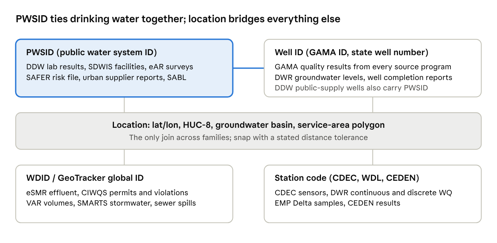

# Water Data Atlas for ML Researchers

*Keith Wilkinson · [title22.org](https://title22.org) · November 2026 · Working draft*

## How to use this atlas

This atlas maps the water data an ML group can use without a data agreement. California state sources are on this page, federal sources on the [Federal data](data-atlas-federal.md) page, and university, utility and international datasets on the [Open research data](data-atlas-open.md) page. For each dataset it gives what a row is, coverage, format, access method, join key and the research directions it serves. Direction and lead numbers refer to [Research Directions & Data Leads](research-directions.md); the [Systems & Data Guide](water-data-guide.md) explains the vocabulary.

**Reading the tables**

- **Access**: *Bulk* = downloadable files. *API* = a queryable endpoint (CKAN datastore, CDEC servlet, ArcGIS REST, OGC API). *App* = interactive web application only.
- **Grain**: what one row is, such as a lab result, a 15-minute reading or a system-year.
- **Key**: the identifier you join on (see *Joining datasets*).
- **Checked**: *opened* = the source page was read in Nov 2026. *search* = confirmed only from search results, so check layout and license before relying on it. Everything on the Federal and Open research pages is *search*.

## At a glance: where each kind of data lives

Public data is strong on what enters and leaves a plant and thin on what happens inside one. This table points to the best source for each need across all three pages.

| Need | California | Federal | Open research |
| --- | --- | --- | --- |
| Treatment-process data (doses, setpoints, filters) | None public | ICR 1997-98 plant database (296 large systems, monthly); ICR treatment studies | Agtrup and Avedøre WWTP SCADA (2-min, Denmark); one daily DWTP coagulant set |
| Drinking-water compliance and occurrence | DDW lab results, SDWIS facilities, eAR, SAFER | Six-Year Review 4, UCMR 1-5, SDWIS via ECHO | None found |
| Treatment-train metadata and removal priors | eAR treatment sections | Treatability Database; CWNS wastewater treatment level | None found |
| Wastewater effluent and operations | eSMR, VAR, sewer spills, stormwater | ICIS-NPDES limits and DMRs, CWNS | Melbourne WWTP energy; UCI plant dataset |
| Source water and the Delta | DWR continuous WQ, EMP, CEDEN, FHAB | USGS APIs, Water Quality Portal, CyAN satellite blooms | GEMStat, GRQA (global) |
| Groundwater | GAMA, DWR levels, well completion reports | USGS samples (also inside GAMA and WQP) | None found |
| Distribution system | Service area boundaries only | National service area boundaries | BattLeDIM, LeakDB, DiTEC-WDN, model libraries; NYC chlorine residual samples |
| Hydrology and operations drivers | CDEC, CIMIS, snow and B120, eWRIMS | National Water Model retrospective, RISE, CWMS, CO-OPS tides | Caravan |
| Wastewater surveillance | Cal-SuWers (CDPH) | CDC NWSS | WastewaterSCAN (CC BY-NC); Stanford repository |

## The access layer

Four access mechanisms cover nearly all California water data: two CKAN open-data portals, the CDEC web services, ArcGIS REST map services and a set of interactive-only applications. Learn these four and every dataset below is reachable.

| Mechanism | Who publishes there | How you query it | Limits and quirks |
| --- | --- | --- | --- |
| [data.ca.gov](https://data.ca.gov) (CKAN) | State Water Board (SWRCB) and most state agencies | `api/3/action/package_search`, `package_show`, `datastore_search?resource_id=…`, `datastore_search_sql?sql=SELECT …`; or plain HTTP download of each resource | Only resources loaded into the *datastore* are queryable. The biggest files (e.g. yearly drinking-water lab CSVs of 450 to 600 MB) are better downloaded whole. [lab.data.ca.gov](https://lab.data.ca.gov) is an experimental friendlier front end over the same catalog. |
| [data.cnra.ca.gov](https://data.cnra.ca.gov) (CKAN) | DWR, Natural Resources agencies, Delta programs | Same CKAN API as above; root `data.cnra.ca.gov/api/3/action/`. DWR publishes a [Python notebook of examples](https://github.com/atcuthbertson/CNRA_OpenData_Accessing) | Many datasets are mirrored on data.ca.gov. DWR's Water Data Library pushes groundwater and discrete water-quality tables here at least weekly; continuous data is published as per-station download links instead ([CWEMF slides](https://cwemf.org/wp/wp-content/uploads/2025/11/03.4_CNRADataPortalAPI_Cuthbertson.pdf), [WDL About](https://wdl.water.ca.gov/About.aspx)). |
| CDEC web services | DWR California Data Exchange Center: real-time stations, reservoirs, snow, rivers, Delta sensors | `cdec.water.ca.gov/dynamicapp/req/CSVDataServlet?Stations=XXX&SensorNums=NN&dur_code=E\|H\|D\|M&Start=YYYY-MM-DD&End=YYYY-MM-DD`; station metadata at `dynamicapp/staMeta?station_id=XXX`. R clients: [cder](https://search.r-project.org/CRAN/packages/cder/vignettes/quickstart.html), [CDECRetrieve](https://flowwest.github.io/CDECRetrieve) | Station default sensors and durations vary, so always specify them. Flow uses sentinel codes such as -9998 / -9997 for below or above the rating table ([FlowWest notes](https://flowwest.github.io/streamFlowExplorer/articles/cdec_template.html)). Real-time values are provisional. |
| ArcGIS REST / WMS | SWRCB `gispublic.waterboards.ca.gov`, DWR `gis.water.ca.gov`, CNRA GIS hub | `…/FeatureServer/0/query?where=1=1&outFields=*&f=geojson&resultOffset=…` | MaxRecordCount is typically 1,000 to 2,000, so page with `resultOffset`. Best source for boundaries and station locations ([SWRCB map services](https://www.waterboards.ca.gov/resources/data_databases/site_map.html)). |
| CIMIS Web API | DWR weather and reference ET (150+ stations plus a 2 km Spatial CIMIS grid) | REST/JSON at [et.water.ca.gov](https://et.water.ca.gov/), hourly and daily | Free but needs an AppKey from a CIMIS account ([FAQ](https://et-proxy.water.ca.gov/Home/Faq)). |
| Interactive applications | CIWQS reports, GeoTracker, GAMA GIS, eWRIMS, SDWIS Drinking Water Watch, CEDEN query tool | Web forms; some offer Excel or CSV export or stable report URLs | CIWQS reports refresh nightly and cap eSMR exports at 100,000 data points per query. Use the bulk copies on data.ca.gov where they exist ([CIWQS public reports](https://waterboards.ca.gov/ciwqs/publicreports.html)). |

**Rule of thumb:** use the CKAN bulk file for training sets, the datastore API or CDEC servlet for incremental updates, and ArcGIS for geometry. Treat the interactive applications as documentation and spot checks, not pipelines.

## What's possible: datasets by research direction

Public data across the three pages can carry eight benchmarks without a utility agreement, and it gives Lead 5 a public warm-up. Each row names the target, the California core data, what federal and open sources add, and a first step.

| Lead or direction | Target | California core | Federal and open complements | First step |
| --- | --- | --- | --- | --- |
| Lead 1: Delta WQ forecasting (dirs 1, 2, 27) | 15-min EC, turbidity, chlorophyll, DO 1 to 7 days ahead | DWR continuous WQ; CDEC flows; EMP grab samples | CO-OPS tides, NWM flows, CyAN blooms | Pull 2005 to 2025, time-ordered splits, persistence and seasonal baselines |
| Lead 2: BSM surrogate and control (dirs 7, 18, 19, 21) | Simulator outputs (Test A) | none needed | Agtrup and Avedøre 2-min SCADA as a real-plant check | Generate BSM2 runs; test the surrogate on Agtrup dynamics |
| Lead 3: distribution residuals (dirs 14, 15) | Chlorine residual at unsensed nodes | Service area boundaries | Benchmark networks (Kentucky, BattLeDIM, DiTEC-WDN) for Test A; NYC distribution samples for Test B | WNTR + EPANET-MSX on one benchmark network, then score against NYC residuals |
| Lead 4: multi-facility effluent (dirs 20, 27) | Next-period effluent ammonia, TSS, BOD, coliform at unseen plants | eSMR, VAR | ICIS-NPDES limits for exceedance labels; CWNS treatment level; other states' DMRs for transfer | Pick \~5 parameters reported by 100+ plants; leave-plants-out split |
| Lead 5: process models before the partnership | Coagulant dose, DBP formation, P removal | none public | ICR 1997-98 plant database; Agtrup and Avedøre; Mendeley DWTP coagulant set | Build the historian loader and dose/DBP baselines on these |
| Small-system failure (dir 17) | Next-year Failing / At-Risk status or first violation | SAFER, DDW lab results, eAR | SDWIS and SYR4 for other states | Rebuild SAFER indicators by year, forecast one year ahead |
| Source vulnerability and PFAS (dirs 16, 25) | Contaminant level at unsampled wells; GAC/IX influent scenarios | GAMA incl. statewide PFAS; well completion reports | UCMR 5; Treatability Database removal priors; EPA PSDM simulator | Spatial cross-validation by basin; feed predicted influents to PSDM |
| Demand forecasting | Monthly production per system | Urban supplier dataset; CIMIS ET | none needed | 400+ series, cross-series benchmark |
| HAB and source-water events | Bloom occurrence near intakes | FHAB reports; CEDEN; CDEC temperature | CyAN satellite index | Weekly classification with FHAB labels, CyAN as a feature |
| Structured extraction | Treatment train and chemicals per plant | eAR treatment sections; SDWIS facilities | CWNS treatment level; ICR plant descriptions | Count how many eAR plants list a process and contaminant removed |

Every row can land on the shared harness's leaderboard; loaders should record source, resource ID, license and download date.

## Joining datasets

Each family of datasets shares one key, and only drinking water and groundwater share a key with each other. Everything else joins through location, so state the spatial tolerance in every merged dataset.



| Key | Typical form | Before joining |
| --- | --- | --- |
| PWSID | `CA` + 7 digits, e.g. `CA4910002` | Normalize to that string form, and keep it as text so leading zeros survive |
| WDID / NPDES / GeoTracker ID | Board-assigned facility and permit numbers | One facility can hold several permits; EPA NPDES IDs can differ from state ones ([ECHO help](https://echo.epa.gov/node/366)) |
| Station code | CDEC 3-letter codes (e.g. `NSL`); WDL station numbers; CEDEN codes | Build a crosswalk table by coordinates; codes are not shared across systems |
| Well ID | GAMA per-source IDs; state well numbers; WCR numbers | OSWCR locations are section centroids, so match on construction details as well as distance |

## Pitfalls and gaps

The data is plentiful but almost none of it was collected for modeling. These are the traps an ML group is most likely to hit in its first month.

- **Self-reported values.** eAR, VAR, conservation reports and water-rights diversions all carry unit errors, duplicates and implausible numbers. The state's own dataset notes say so. Build unit checks and flag outliers before training.
- **Compliance sampling is not random sampling.** Sampling frequency rises after an exceedance and falls when a source is clean. Models trained naively will learn the monitoring schedule, not the chemistry.
- **Non-detects.** Lab results report values below the reporting limit as flags, not zeros. Treat them as censored data and keep the reporting limit as a feature.
- **Changing permits and methods.** eSMR parameter sets change when permits are renewed. CEDEN mixes many programs and methods, and continuous sensors are swapped and recalibrated. Use the quality flags and quality reports.
- **Provisional data.** CDEC and USGS real-time values are revised later. Train on approved records and score on what would have been known at forecast time.
- **Mixed licenses.** Most Water Board data is public domain or ODC-BY, DWR Delta data is CC BY, while some EMP versions, WastewaterSCAN and part of GEMStat are non-commercial (CC BY-NC). Record the license per resource in the registry.
- **Moving targets.** Datasets migrate: wastewater surveillance moved to data.chhs.ca.gov in 2024, eAR production moved to the SAFER Clearinghouse in 2023, and USGS replaced WaterServices in 2026. Pin resource IDs and keep raw snapshots.
- **Coarse locations.** Well completion reports are located to the 1-mile section, and some boundaries are still being verified. Spatial models should carry location uncertainty.

**The gap that matters most** has narrowed but not closed. Open wastewater SCADA (Agtrup, Avedøre) and EPA's 1997-98 ICR plant records now give real process data, but there is still no open, recent, high-frequency drinking-water process record: doses, filter head loss, contactor residuals and operator actions live only inside utilities. Lead 5 remains the critical path.

## California: drinking water

The drinking-water stack is the richest regulatory record in the state. It holds every compliance lab result since the 1970s, every system's inventory, annual operating surveys and a statewide risk score. It is all keyed on the public water system ID (PWSID, e.g. `CA4910002`), which makes it the easiest domain to join.

| Dataset | What one row is | Coverage and size | Access | Key | Checked |
| --- | --- | --- | --- | --- | --- |
| [DDW drinking water lab results](https://lab.data.ca.gov/dataset/drinking-water-open-environmental-data-project-march-23-2023-workshop) | One lab analysis: sample point, analyte (STORET code), result, MCL, date | One CSV per year, \~450 to 600 MB each for 2020 to 2025, plus an all-since-1978 ZIP (359 MB); lab uploads publish twice monthly | Bulk CSV (data.ca.gov); datastore API on some years; legacy 1974 to 2010 DBF/CSV with Siteloc, Watsys, Lab and Storet lookup tables on the [EDT library](https://waterboards.ca.gov/drinking_water/certlic/drinkingwater/EDTlibrary.html) | PWSID + source/sample-point ID; STORET analyte code | search |
| [Public water system information (Drinking Water Watch)](https://catalog.data.gov/dataset/drinking-water-public-water-system-information) | One facility (well, intake, treatment plant, storage, distribution entry point) of a PWS | All CA systems, \~2.7 MB CSV | Bulk CSV + data dictionary; source app [SDWIS Drinking Water Watch](https://sdwis.waterboards.ca.gov/PDWW/) has violations, enforcement and samples | PWSID + facility ID | search |
| [eAR production and delivery 2013 to 2022](https://catalog.data.gov/dataset/drinking-water-public-water-system-annually-reported-water-production-and-delive-2013-2022) | Monthly volume by system, source type (ground, surface, purchased, recycled) and use type | Per-year CSVs, 2022 file \~221 MB; self-reported, with known unit errors | Bulk CSV + datastore API; 2023 onward moved to the SAFER Clearinghouse and is not yet republished | PWSID | search |
| [eAR full survey (flat files)](https://waterboards.ca.gov/drinking_water/certlic/drinkingwater/ear.html) | One answer to one survey question, per system-year | 2013 onward; small and large systems split until 2019, combined since 2020; [HydroShare parser scripts](https://beta.hydroshare.org/resource/8108599db4934252a5d0e6e83b5d3551) pivot it to one row per system | Bulk text from the eAR page | PWSID | search |
| [Service connections (eAR)](https://lab.data.ca.gov/dataset/drinking-water-public-water-system-number-of-service-connections-service-connection-type/8c633f58-b064-4290-82bc-ed68c9015bf6) | Connections by type and metered/unmetered, per system-year | 2013 to 2023, \~790 MB | Bulk CSV | PWSID | search |
| [SAFER risk assessment and failing list](https://lab.data.ca.gov/dataset/safer-failing-and-at-risk-drinking-water-systems) | One community or school water system with its risk-indicator scores and a Failing / At-Risk status | Annual Needs Assessment since 2021; Failing list updated daily on the [dashboard](https://water.waterboards.ca.gov/drinking_water/certlic/drinkingwater/2022.html) | Bulk CSV flat file + data dictionary; methodology in each year's [Needs Assessment](https://waterboards.ca.gov/drinking_water/certlic/drinkingwater/needs.html) | PWSID | search |
| [Urban retail supplier conservation, supply and demand](https://catalog.data.gov/dataset/urban-retail-water-supplier-water-conservation-supply-and-demand-june-2014-onwards) | Monthly production and use per urban supplier (>3,000 connections or >3,000 AF/yr) | June 2014 onward, 400+ systems serving \~95% of the population ([Maven's Notebook](https://mavensnotebook.com/2024/06/26/now-available-state-water-board-relaunches-updated-water-use-tracker/)); ODC-BY license | Bulk CSV + datastore API; includes a modified z-score data flag | PWSID | search |
| [System service area boundaries (SABL)](https://gispublic.waterboards.ca.gov/portalserver/rest/services/Drinking_Water/California_Drinking_Water_System_Area_Boundaries/FeatureServer) | One polygon per system, with verification status | Statewide; DDW still validating boundaries | ArcGIS FeatureServer (paged) or shapefile | `SABL_PWSID` | search |

**What's possible.** Joining lab results to facilities and eAR treatment sections gives source-to-tap chemistry for thousands of systems, labeled with what treatment each source gets. That supports small-system failure prediction (direction 17), DBP and nitrate exceedance forecasting, and the structured-extraction direction. The eAR also lists each non-chlorination treatment plant, its process and the contaminant removed. That is the closest public record of statewide treatment trains, and it is worth confirming field by field.

**What's missing.** Results are compliance samples, so they come monthly to annually and only for regulated analytes. There are no doses, setpoints or process readings.

## California: wastewater, discharges and recycled water

The eSMR effluent record is the deepest multi-facility dataset of the whole atlas: 2006 to present, every NPDES permit holder. Around it sit annual volumes, sewer spills, stormwater sampling and wastewater surveillance. Most of it is keyed on the Water Board's WDID facility ID, which links to CIWQS permits and violations.

| Dataset | What one row is | Coverage and size | Access | Key | Checked |
| --- | --- | --- | --- | --- | --- |
| [eSMR effluent and receiving-water data](https://publish.data.ca.gov/dataset/water-quality-effluent-electronic-self-monitoring-report-esmr-data) | One analytical or calculated result at a monitoring location (effluent, influent, receiving water) | 2006 to present, monthly updates; \~279 MB Parquet or \~850 MB/yr CSV; public domain | Bulk CSV or Parquet + datastore API; CIWQS eSMR report for small pulls (Excel, 100k-point cap) | WDID / facility + monitoring location | opened |
| [CIWQS facilities, violations, enforcement](https://waterboards.ca.gov/ciwqs/publicreports.html) | One facility, violation or enforcement action | All Water Board programs; nightly refresh; violation and enforcement tables also on data.ca.gov | App reports with Excel export and stable URLs; NPDES permit list as Excel | WDID, place ID, order number | opened |
| [Sanitary sewer spills](https://waterboards.ca.gov/ciwqs/publicreports.html) | One spill event, or one no-spill certification, per enrollee | Statewide sewer-system general order enrollees | Flat files (format not stated) + nightly GIS incident maps | Enrollee / WDID | opened |
| [Volumetric Annual Report (VAR)](https://catalog.data.gov/dataset/volumetric-annual-report-of-wastewater-and-recycled-water) | Monthly influent, effluent and reuse volume per facility, plus treatment level | Annual since 2019, \~756 treatment plants and recycled-water producers in the [2019 report](https://waterboards.ca.gov/water_issues/programs/recycled_water/docs/2021/210105_VAR_BoardInfoItem.pdf); self-reported through GeoTracker | Bulk CSV (facilities, influent, effluent, reuse) + datastore API + data dictionary | GeoTracker global ID / WDID | search |
| [Stormwater (SMARTS) monitoring and enforcement](https://lab.data.ca.gov/dataset/stormwater-regulatory-including-enforcement-actions-information-and-water-quality-results) | One stormwater sample result at an industrial or construction site | Industrial monitoring \~660 MB, construction \~315 MB CSV; inspections and violations tables | Bulk CSV + datastore API; [SMARTS public reports](https://smarts.waterboards.ca.gov/smarts/SwPublicUserMenu.xhtml) | WDID | search |
| [Wastewater surveillance (Cal-SuWers)](https://catalog.data.gov/dataset/cdph-wastewater-surveillance-data-california) | One influent sample: pathogen target concentration, flow, sewershed | Moved to [data.chhs.ca.gov](https://data.chhs.ca.gov/dataset/wastewater-surveillance-data-california) in Sept 2024; historic COVID-era file on data.ca.gov | Bulk CSV + datastore API; follows the CDC NWSS data dictionary | Sewershed / plant ID | search |

**What's possible.** eSMR is the only public route to cross-facility transfer (Lead 4, directions 20 and 27): forecast effluent ammonia, TSS or coliform at plants never seen in training. VAR adds monthly flows and treatment level as covariates. The sewer-spill table supports event prediction, and the surveillance data adds a high-signal influent series for the participating plants.

**What's missing.** eSMR reports what the permit requires, so frequency ranges from daily to quarterly and the parameter set changes by permit. There is no aeration, sludge-age or chemical-dose data. Pair it with the BSM1/BSM2 simulators (Lead 2) for Test A work.

## California: surface water quality and the Delta

This is source water as treatment plants see it. Two layers matter. The Delta and State Water Project have high-frequency sensor networks and 50 years of monthly sampling. Statewide, the CEDEN aggregate holds grab samples from hundreds of monitoring programs.

| Dataset | What one row is | Coverage and size | Access | Key | Checked |
| --- | --- | --- | --- | --- | --- |
| [DWR Delta continuous WQ (Central Delta)](https://publish.data.ca.gov/dataset/sacramento-san-joaquin-bay-delta-continuous-15-minute-water-quality-monitoring-central-delta-re) | 15-minute reading of conductivity, temperature, DO, turbidity, chlorophyll or fluorescence | 12 stations, Oct 2005 to Dec 2025, yearly updates; CC BY; includes a quality report | Bulk CSV | Station code | opened |
| [DWR continuous data download links](https://catalog.data.gov/dataset/dwr-continuous-data-download-links) | One station-parameter time-series file (stage, flow, water quality) from DWR's Hydstra database | Statewide DWR continuous stations | Stations, parameters and a station-trace table of per-series download URLs on data.cnra.ca.gov; not in the datastore | Station number + parameter | search |
| [DWR discrete water quality (Water Data Library)](https://lab.data.ca.gov/dataset/water-quality-data) | One lab or field result for a grab sample | Early 1900s to present, mostly analyzed by DWR's Bryte lab; covers surface water, groundwater and drinking water | Bulk CSV (stations, period of record, lab results, field results) on data.cnra.ca.gov, refreshed at least weekly; [WDL app](https://wdl.water.ca.gov/About.aspx) | Station number | search |
| [EMP discrete water quality, Bay-Delta](https://lab.data.ca.gov/dataset/emp-discrete-water-quality-data) | One monthly sample: nutrients, chlorophyll, DOC/TOC, field parameters at surface and bottom | 1975 to 2023; \~28 stations monthly by 2018 | Bulk CSV + flag codes + methods PDF; also on [EDI](https://portal.edirepository.org/nis/mapbrowse?scope=edi&identifier=458&revision=12) | Station code | search |
| [discretewq integrated Delta WQ](https://rdrr.io/github/sbashevkin/discretewq/f/README.Rmd) | Harmonized discrete WQ from many IEP surveys and DWR | San Francisco Estuary, decades | R package from the Interagency Ecological Program | Source + station | search |
| [State Water Project routine WQ](https://lab.data.ca.gov/dataset/state-water-project-routine-water-quality-monitoring) | One sample along the aqueduct system | CSV from 2010 onward; earlier only as lab reports | Bulk CSV on data.cnra.ca.gov; pre-2020 Bryte data on WDL | Station | search |
| [CEDEN surface water chemistry](https://data.amerigeoss.org/dataset/surface-water-chemistry-results) | One field or lab chemistry result from any contributing program | Yearly CSVs \~2000 to 2025; plus a CEDEN *augmentation* set not yet loaded into CEDEN | Bulk CSV per year, all-years ZIP or Parquet, datastore API; [CEDEN query tool](https://ceden.waterboards.ca.gov/AdvancedQueryTool) | Station code + project | search |
| [CEDEN habitat, toxicity, bacteria, tissue, benthic](https://catalog.data.gov/dataset/?tags=ceden) | One field measurement, toxicity test, indicator-bacteria result (incl. BeachWatch), tissue or taxon result | Toxicity CSV alone is \~1.3 GB; each has a data-quality indicator column | Same pattern as chemistry | Station code | search |
| [Freshwater harmful algal blooms](https://catalog.data.gov/dataset/surface-water-freshwater-harmful-algal-blooms) | One bloom report, case, response or lab result | Statewide voluntary reports via the [CA HABs portal](https://mywaterquality.ca.gov/habs/index.html) | Bulk CSV (reports, cases, responses, results) + datastore API | Report / waterbody ID | search |

**What's possible.** Lead 1 (Delta WQ forecasting) can use 20 years of 15-minute sensors, with EMP and WDL grab samples as slow ground truth and CDEC flows as drivers. CEDEN and FHAB support HAB-risk and source-water event models for intakes (directions 1, 2 and 27).

**What's missing.** Utility intake monitoring rarely reaches these systems. EMP's license varies by version (one catalog entry lists CC BY-NC), so check before redistributing.

## California: groundwater

Groundwater supplies a large share of California's drinking water, and its data is unusually well consolidated. GAMA merges quality results from many programs into one schema. DWR publishes levels, well construction and subsidence alongside it.

| Dataset | What one row is | Coverage and size | Access | Key | Checked |
| --- | --- | --- | --- | --- | --- |
| [GAMA groundwater quality](https://catalog.data.gov/dataset/ground-water-water-quality-results) | One untreated-well result: well, chemical, value, date, source program | Files per source: DDW public-supply wells split into pre-2000, 2000s, 2010s and 2020-present (largest \~1.6 GB); USGS NWIS (\~650 MB); DWR, DPR, irrigated lands, LA County WRD, GAMA domestic wells; statewide PFAS (\~39 MB); all-wells locations; quarterly updates | Bulk CSV + datastore API on data.ca.gov; [GAMA GIS download page](https://gamagroundwater.waterboards.ca.gov/gama/datadownload) by county | GAMA well ID; DDW wells carry PWSID + source ID | opened |
| [DWR periodic groundwater levels](https://data.amerigeoss.org/dataset/periodic-groundwater-level-measurements) | One depth-to-water measurement at a monitoring well | Decades, seasonal (spring/fall) plus some monthly; measurements CSV \~336 MB; stations \~5 MB; perforations table | Bulk CSV or ZIP on data.cnra.ca.gov; datastore API; also on WDL and the SGMA viewer | Site code / state well number | search |
| [DWR continuous groundwater levels](https://www.lab.data.ca.gov/dataset/continuous-groundwater-level-measurements) | Sub-daily logger reading at an instrumented well | Fewer wells, higher frequency | Bulk CSV + API on data.cnra.ca.gov | Site code | search |
| [Well completion reports (OSWCR)](https://www.lab.data.ca.gov/dataset/well-completion-reports) | One well's construction record: depth, screen, casing, lithology, use | Statewide, period of record; mostly located only to the 1-mile PLSS section centroid; [USGS attributed version](https://data.usgs.gov/datacatalog/data/USGS:64958d73d34ef77fcb01dc8f) covers \~297,000 supply wells | Bulk CSV tables + bulk ZIP + ArcGIS FeatureServer + redacted PDFs by county | WCR number; state well number | search |
| [GeoTracker regulated sites and monitoring](https://lab.data.ca.gov/dataset/ground-water-water-quality-regulatory-information) | One cleanup or permitted site; or one EDF lab result or depth-to-water reading at a site well | Sites CSV \~65 MB; per-county and statewide EDF downloads ([Water Boards data table](https://www.waterboards.ca.gov/resources/data_databases)) | Bulk CSV (sites) + zipped EDF text files (monitoring); app search | GeoTracker global ID + field point name | search |
| [CalGW Live and SGMA data](https://catalog.data.gov/dataset/californias-groundwater-live-supporting-data) | Derived level statistics, InSAR subsidence rasters, GSP monitoring and annual-report tables | Statewide; InSAR by water year | data.cnra.ca.gov resources, ArcGIS services, [SGMA Data Viewer](https://sgma.water.ca.gov/webgis/config/custom/html/SGMADataViewer/doc) | Basin / GSA ID | search |

**What's possible.** GAMA plus well construction lets models predict nitrate, arsenic, 1,2,3-TCP or PFAS at unsampled wells from screen depth, land use and neighbours. That feeds direction 16 (source vulnerability) and the PFAS GAC/IX surrogate candidate (direction 25) with realistic influent distributions. Linking DDW wells by PWSID connects raw groundwater to the drinking-water compliance record downstream.

**What's missing.** GAMA holds untreated water only. Sampling is irregular, and well locations in OSWCR are coarse.

## California: hydrology, supply and use

These datasets are the drivers and covariates for almost every water-quality model. Flow, stage, reservoir release, snowmelt, rain and ET explain much of the variance in source water and in demand. CDEC is the workhorse, and nearly everything here is free with no key except CIMIS.

| Dataset | What one row is | Coverage and size | Access | Key | Checked |
| --- | --- | --- | --- | --- | --- |
| [CDEC station sensors](https://flowwest.github.io/streamFlowExplorer/articles/cdec_template.html) | One reading of one sensor (flow, stage, EC, temperature, reservoir storage, precip, snow) | Stations from many cooperating agencies; event (\~15 min), hourly, daily and monthly durations | CSV servlet and JSON/CSV group web services ([group form](https://cdec.water.ca.gov/dynamicapp/groupform)); R `cder`, `CDECRetrieve` | 3-letter station + sensor number + duration code | search |
| [Snow data and Bulletin 120](https://lab.data.ca.gov/dataset/california-snow-data) | Daily snow water content per sensor; monthly snow course; seasonal runoff forecasts | Daily SWC 1954 to present in decade files; B120 forecasts issued Feb to May ([DWR forecast notice](https://content.govdelivery.com/attachments/CNRA/2026/03/09/file_attachments/3578140/WSFCastDiscussion.pdf)) | Bulk CSV on data.cnra.ca.gov; B120 and WSI as CDEC report pages | Station / snow course ID | search |
| [CIMIS weather and reference ET](https://catalog.data.gov/dataset/cimis-weather-station-spatial-cimis-data-web-api) | Hourly or daily ETo, air temperature, solar radiation, wind, precip at a station or 2 km grid cell | 150+ stations; Spatial CIMIS grid | REST/JSON; free AppKey ([FAQ](https://et-proxy.water.ca.gov/Home/Faq)) | Station number or zip code | search |
| [Water rights and reported diversions (eWRIMS)](https://data.amerigeoss.org/dataset/california-water-rights-water-use-reported) | One annual report x water right x month x diversion type | Reports from 1914; detail summary list \~470 MB | Bulk CSV + data dictionaries; wide-format export from eWRIMS | Application / water right ID; POD | search |
| Urban supplier production (see *Drinking water*) | Monthly potable production per supplier | June 2014 onward | Bulk CSV + API | PWSID | search |

The State Water Board itself warns that diversion reports contain duplicate reports, unit-conversion errors and missing years ([demand methodology](https://waterboards.ca.gov/drought/drought_tools_methods/docs/2022/demand-data-analysis-methodology-overview.pdf)). Treat them as noisy labels.

**What's possible.** CDEC flows, Delta exports and EC drive Lead 1. Production plus CIMIS ET and temperature gives a clean demand-forecasting benchmark across 400+ systems. Snow and B120 add seasonal context for source-water temperature and turbidity. The adjacent hydrology track (direction 32) sits here; CalSim and IWFM remain deprioritized.

## Quick-start code

Four patterns cover most pulls. The snippets follow each service's documented URL scheme but were not run from this workspace, because its network can't reach state sites. Expect small fixes on first use.

```python
import requests, pandas as pd, io

# 1. CKAN: find datasets, then query a datastore resource with SQL
CKAN = "https://data.ca.gov/api/3/action"          # or https://data.cnra.ca.gov/api/3/action
hits = requests.get(f"{CKAN}/package_search", params={"q": "eSMR", "rows": 5}).json()
for p in hits["result"]["results"]:
    print(p["name"], [r["id"] for r in p["resources"]][:3])

RID = "<resource-id>"                                # copy from the resource page
sql = f'SELECT * FROM "{RID}" WHERE "parameter" = \'Ammonia, Total (as N)\' LIMIT 1000'
rows = requests.get(f"{CKAN}/datastore_search_sql", params={"sql": sql}).json()["result"]["records"]
df = pd.DataFrame(rows)

# For training sets, download the whole file instead (Parquet where offered)
# df = pd.read_parquet("<resource download URL>")

# 2. CDEC: one station, one sensor, one duration
url = ("https://cdec.water.ca.gov/dynamicapp/req/CSVDataServlet"
       "?Stations=NSL&SensorNums=100&dur_code=E&Start=2024-01-01&End=2024-01-31")
cdec = pd.read_csv(url, na_values=["---"])        # check DATA_FLAG and sentinel codes

# 3. ArcGIS REST: page through a FeatureServer layer
layer = ("https://gispublic.waterboards.ca.gov/portalserver/rest/services/"
         "Drinking_Water/California_Drinking_Water_System_Area_Boundaries/FeatureServer/0/query")
feats, off = [], 0
while True:
    r = requests.get(layer, params={"where": "1=1", "outFields": "*", "f": "geojson",
                                    "resultOffset": off, "resultRecordCount": 1000}).json()
    feats += r["features"]
    if len(r["features"]) < 1000: break
    off += 1000

# 4. USGS (new OGC APIs)
# pip install dataretrieval ; set API_USGS_PAT for higher rate limits
from dataretrieval import waterdata
q, meta = waterdata.get_daily(monitoring_location_id="USGS-11447650", parameter_code="00060",
                              time="2024-01-01/2024-12-31")
```

The USGS site in example 4 is the Sacramento River at Freeport; any `USGS-` ID works. For the shared harness, wrap each pattern in a loader that writes raw files plus a JSON sidecar with source URL, resource ID, license and retrieval time.

## Sources (California and overview)

Two pages were opened directly in November 2026: [CIWQS public reports](https://waterboards.ca.gov/ciwqs/publicreports.html) and the [Water Boards data site map](https://www.waterboards.ca.gov/resources/data_databases/site_map.html). Rows marked *opened* also draw on the Nov 2026 checks recorded in the directions doc. Everything else comes from catalog metadata (data.ca.gov, lab.data.ca.gov, catalog.data.gov mirrors) seen through search results, so confirm sizes and fields on the live resource page.

- Portals and access: [CNRA Open Data API slides (CWEMF 2025)](https://cwemf.org/wp/wp-content/uploads/2025/11/03.4_CNRADataPortalAPI_Cuthbertson.pdf) · [DWR Water Data Library, About](https://wdl.water.ca.gov/About.aspx) · [cder quickstart](https://search.r-project.org/CRAN/packages/cder/vignettes/quickstart.html) · [FlowWest CDEC notes](https://flowwest.github.io/streamFlowExplorer/articles/cdec_template.html) · [CIMIS API FAQ](https://et-proxy.water.ca.gov/Home/Faq) · [AB 1755 program](https://water.ca.gov/Programs/All-Programs/AB-1755)
- Drinking water: [Drinking water open data workshop bundle](https://lab.data.ca.gov/dataset/drinking-water-open-environmental-data-project-march-23-2023-workshop) · [Public water system information](https://catalog.data.gov/dataset/drinking-water-public-water-system-information) · [eAR page](https://waterboards.ca.gov/drinking_water/certlic/drinkingwater/ear.html) · [eAR production 2013 to 2022](https://catalog.data.gov/dataset/drinking-water-public-water-system-annually-reported-water-production-and-delive-2013-2022) · [SAFER dataset](https://lab.data.ca.gov/dataset/safer-failing-and-at-risk-drinking-water-systems) · [Needs Assessment](https://waterboards.ca.gov/drinking_water/certlic/drinkingwater/needs.html) · [Urban supplier conservation dataset](https://catalog.data.gov/dataset/urban-retail-water-supplier-water-conservation-supply-and-demand-june-2014-onwards)
- Wastewater: [eSMR](https://publish.data.ca.gov/dataset/water-quality-effluent-electronic-self-monitoring-report-esmr-data) · [VAR](https://catalog.data.gov/dataset/volumetric-annual-report-of-wastewater-and-recycled-water) · [Stormwater SMARTS](https://lab.data.ca.gov/dataset/stormwater-regulatory-including-enforcement-actions-information-and-water-quality-results) · [Wastewater surveillance](https://catalog.data.gov/dataset/cdph-wastewater-surveillance-data-california)
- Surface water: [Delta continuous WQ](https://publish.data.ca.gov/dataset/sacramento-san-joaquin-bay-delta-continuous-15-minute-water-quality-monitoring-central-delta-re) · [DWR continuous download links](https://catalog.data.gov/dataset/dwr-continuous-data-download-links) · [DWR discrete WQ](https://lab.data.ca.gov/dataset/water-quality-data) · [EMP discrete WQ](https://lab.data.ca.gov/dataset/emp-discrete-water-quality-data) · [CEDEN chemistry](https://data.amerigeoss.org/dataset/surface-water-chemistry-results) · [CEDEN toxicity](https://www.lab.data.ca.gov/dataset/surface-water-toxicity-results) · [FHAB](https://catalog.data.gov/dataset/surface-water-freshwater-harmful-algal-blooms)
- Groundwater: [GAMA quality results](https://catalog.data.gov/dataset/ground-water-water-quality-results) · [Periodic GW levels](https://data.amerigeoss.org/dataset/periodic-groundwater-level-measurements) · [Well completion reports](https://www.lab.data.ca.gov/dataset/well-completion-reports) · [GeoTracker sites](https://lab.data.ca.gov/dataset/ground-water-water-quality-regulatory-information) · [CalGW Live supporting data](https://catalog.data.gov/dataset/californias-groundwater-live-supporting-data)
- Hydrology and use: [California snow data](https://lab.data.ca.gov/dataset/california-snow-data) · [CIMIS Web API](https://catalog.data.gov/dataset/cimis-weather-station-spatial-cimis-data-web-api) · [Water rights water use](https://data.amerigeoss.org/dataset/california-water-rights-water-use-reported) · [Demand methodology](https://waterboards.ca.gov/drought/drought_tools_methods/docs/2022/demand-data-analysis-methodology-overview.pdf)
- Federal: [USGS WaterServices decommission](https://waterdata.usgs.gov/blog/api-waterservices-decom) · [dataretrieval on PyPI](https://pypi.org/project/Dataretrieval/) · [WQP web services](https://waterqualitydata.us/webservices_documentation) · [ECHO data downloads](https://echo.epa.gov/node/113)
