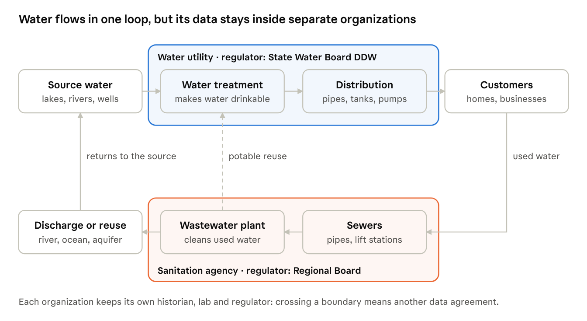
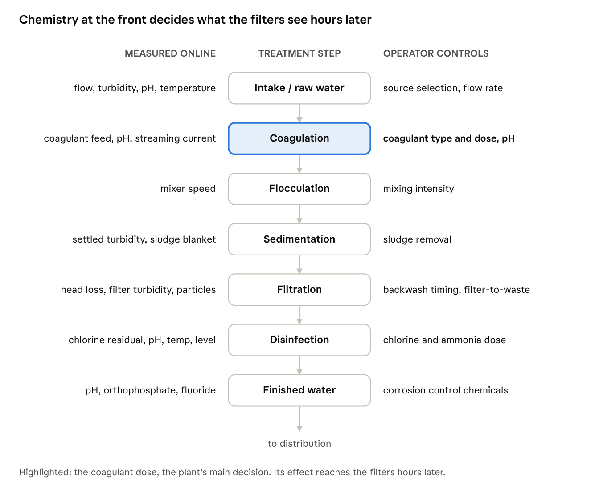
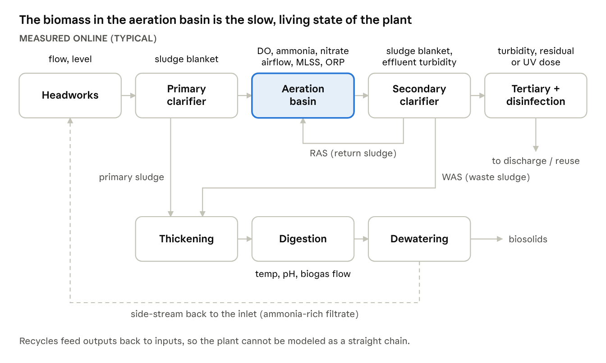
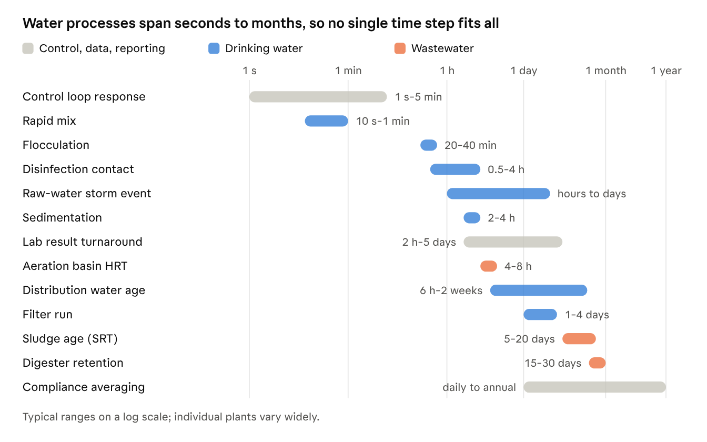
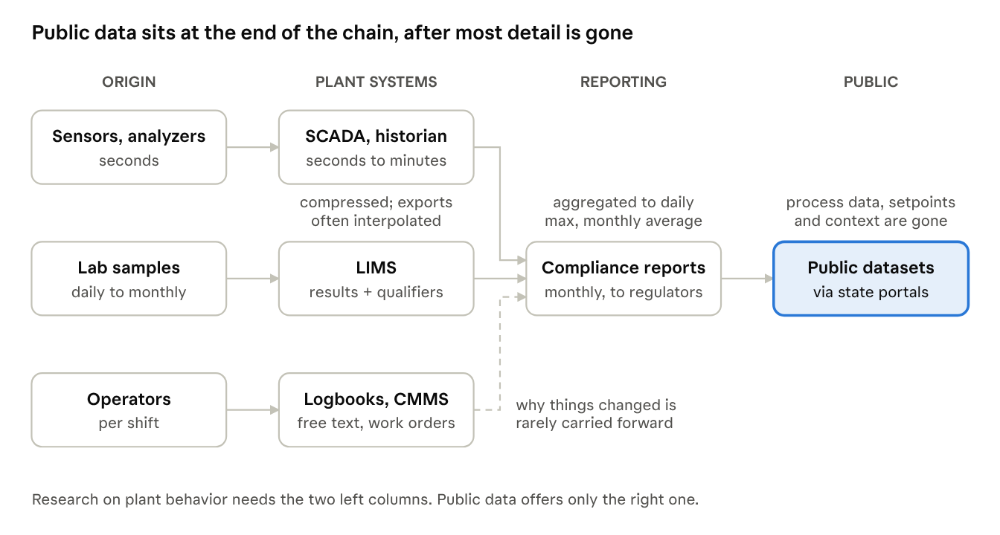

# Water Systems and Data: A Guide for ML Collaborators

*Keith Wilkinson · [title22.org](https://title22.org) · November 2026*

Water utilities run continuous physical processes under regulation, and their data is shaped by both. This guide gives the shape of the system, where data comes from, and the vocabulary. The aim is enough to frame ML problems correctly, not enough to design a plant.

## The big picture

Urban water is one loop run by separate organizations. Each has its own regulator, data systems and incentives, so data almost never crosses the boundaries. Drinking water and wastewater are usually different utilities, or at least different departments with different historians and labs.

The dashed line is potable reuse, which links the two organizations directly and is growing in California.

| Segment | Who runs it | Who regulates it (California) | Main data it produces |
| --- | --- | --- | --- |
| Source water | Wholesalers, state and federal projects, the utility itself | State Water Board (water rights); DWR operates the State Water Project | Flows, reservoir levels, raw-water quality |
| Drinking water treatment | Water utility | State Water Board, Division of Drinking Water (DDW), under the Safe Drinking Water Act | High-frequency process data, lab results, compliance reports |
| Distribution | Water utility | DDW | Pressures, tank levels, residual sampling, customer meters |
| Collection (sewers) | Sanitation agency or city | Regional Water Boards (spill reporting) | Flows, lift-station data, overflow reports |
| Wastewater treatment | Sanitation agency | Regional Water Boards via NPDES permits, under the Clean Water Act | Process data, effluent lab results, monthly self-monitoring reports |
| Discharge or reuse | Sanitation agency, reuse agency | Regional Boards (discharge); DDW (recycled water, potable reuse) | Effluent quality, reuse-barrier monitoring |

The structure matters for ML: a model that needs data from two segments usually needs two data agreements.

## Drinking water treatment

A conventional surface-water plant is a chain of physical and chemical steps. Each step depends on the one before, and the operator's main lever is chemistry at the front. What happens at coagulation shows up hours later at the filters, so the strongest relationships in the data are lagged.

| Unit | Purpose | Measured online (typical) | What operators control | Where ML can help |
| --- | --- | --- | --- | --- |
| Intake / raw water | Bring in source water | Flow, turbidity, pH, temperature, conductivity; sometimes TOC/UV254, algae probes | Which intake or source, flow rate, pre-oxidant | Forecasting raw-water changes before they arrive |
| Coagulation (rapid mix) | Neutralize particle charge so particles can stick together | Coagulant feed rate, pH, sometimes streaming current | Coagulant type and dose, pH adjustment | Dose prediction; the plant's most important decision |
| Flocculation | Gentle mixing to grow particles into floc | Mixer speed; little else | Mixing intensity | Rarely modeled directly |
| Sedimentation (or DAF) | Let floc settle (or float off) | Settled-water turbidity, sludge blanket level | Sludge removal timing | Settled turbidity forecasting as a dose feedback |
| Filtration | Remove remaining particles through sand/anthracite media | Per-filter flow, head loss, effluent turbidity, particle counts | Backwash timing, filter-to-waste, loading rate | Run-length and breakthrough forecasting |
| Disinfection (clearwell) | Inactivate pathogens; leave a residual for the pipes | Chlorine residual, pH, temperature, flow, clearwell level | Chlorine dose, ammonia dose (for chloramine) | Residual control, CT forecasting |
| Finished water conditioning | Corrosion control, fluoride | pH, alkalinity, orthophosphate, fluoride | Caustic, phosphate, fluoride feed | Corrosion and lead-risk modeling |

Common variants replace or add steps: ozone (before or after sedimentation), GAC adsorption, membranes instead of conventional filters, or direct filtration that skips sedimentation. Groundwater systems often have only disinfection plus targeted treatment (arsenic, nitrate, PFAS).

## Wastewater treatment

A wastewater plant is a biological reactor wrapped in physical separation. Its key state is a living microbial population that changes over days to weeks. That makes it slower, more nonlinear and more history-dependent than drinking water treatment. The plant has two linked streams, liquid and solids, and recycle flows feed back from the second to the first.

| Unit | Purpose | Measured online (typical) | What operators control | Where ML can help |
| --- | --- | --- | --- | --- |
| Headworks (screens, grit) | Remove rags, grit and debris | Influent flow, level; sometimes pH, conductivity | Screen and grit cycles | Influent flow forecasting from weather and diurnal pattern |
| Primary clarifier | Settle out solids and some organic load | Sludge blanket; little else | Sludge pumping | Load estimation for downstream units |
| Aeration basin (activated sludge) | Microbes consume organics and convert ammonia (nitrification), often also remove nitrogen and phosphorus | Dissolved oxygen, ammonia, nitrate, airflow, MLSS, ORP | DO setpoints, airflow, internal recycle, wasting rate | Soft sensors, aeration energy optimization, upset early warning |
| Secondary clarifier | Separate biomass from treated water, return most of it | Sludge blanket, effluent turbidity | Return (RAS) and waste (WAS) rates | Bulking and washout prediction |
| Tertiary filtration + disinfection | Polish and disinfect for discharge or reuse | Turbidity, chlorine residual or UV dose, flow | Chemical dose, UV power | Residual control, effluent compliance forecasting |
| Solids: thickening, digestion, dewatering | Reduce and stabilize sludge; anaerobic digesters make biogas | Digester temperature, pH, gas flow and composition | Feed rate, temperature, polymer dose | Digester upset prediction, gas forecasting |

Two control knobs dominate. Aeration is usually the plant's largest energy cost. Sludge wasting sets the sludge age (SRT), which decides which microbes survive.

## Time scales

The time scale sets the forecast horizon and the sampling rate a model needs. A filter-run model needs minute-level data over days. A sludge-age model needs daily data over months. It also explains why lab results, which arrive hours to days after sampling, are hard to use for fast decisions. *Ranges are typical textbook and operating values; individual plants vary widely.*

## Where data comes from

Plant data comes from five or six separate systems that were never designed to be joined. Most public data is the last, most aggregated step of that chain: monthly compliance reports built from daily summaries of high-frequency readings. Each step drops detail and context.

| Source | Typical resolution | Created by | Quirks to expect |
| --- | --- | --- | --- |
| SCADA / PLC | Sub-second to seconds | Instruments, control system | Real-time only; not kept long-term |
| Historian (PI/AVEVA, Ignition, Wonderware and others) | Stored on change; exported at 1 s to 15 min | Automatic from SCADA | Compression and deadbands mean exported "1-min data" is often interpolated. Tag names are cryptic and plant-specific. |
| Online analyzers (turbidity, chlorine, ammonia, TOC) | Seconds to minutes | Instruments | Drift between calibrations, flatlines during maintenance, step jumps after calibration, out-of-range codes |
| Lab / LIMS | Daily to monthly grab or composite samples | Plant or contract lab | Detection limits and qualifiers ("<0.5", ND); sample time differs from analysis and entry time |
| Operator logbooks and rounds | Per shift; free text | Operators | Event times approximate; the only record of why something changed |
| Maintenance system (CMMS) | Per work order | Maintenance staff | Asset IDs rarely match historian tags |
| Compliance reports (monthly operating reports, eSMR) | Daily values, monthly summaries | Utility staff, submitted to regulators | Already aggregated (daily max, monthly average); the source of most public data |
| Network model and GIS | Static, updated occasionally | Engineers | Calibration quality varies; security-sensitive |
| Customer meters (AMI) | 15 min to hourly | Meter network | Privacy-restricted; usually a separate system |

The key join keys are time and location. Time is often local with daylight-saving jumps. Location is a tag name, a sample point code or a facility ID, each from a different system.

## Data pitfalls

The most dangerous trap is that plant data is generated under control. Operators and control loops react to the very variables a model is trying to learn. Most of the traps below can't be seen from the data alone, so ask the domain expert before trusting a correlation.

| Pitfall | What it looks like | What to do |
| --- | --- | --- |
| Control-loop confounding | Coagulant dose rises when raw turbidity rises, so a naive model learns "more coagulant, worse water" | Model the response conditional on operator action; use designed experiments or causal methods where possible |
| Setpoint vs measured value | Tags for setpoint (SP), measured value (PV) and output (OUT) look alike; the setpoint leaks the operator's intent | Get the tag list annotated; keep SP and OUT as inputs only when they're truly known in advance |
| Flow-dependent lags | Cause and effect are hours apart, and the lag shrinks as flow rises | Align by residence time computed from flow and volume, not a fixed shift |
| Historian interpolation | Smooth straight lines across outages; fake precision | Export recorded values, not interpolated ones, or flag gaps explicitly |
| Analyzer maintenance | Flatlines, zeros, spikes, and step changes after calibration | Get maintenance records; build a data-quality flag before any modeling |
| Units in and out of service | A filter shows zero flow; total plant flow splits across a changing number of units | Track unit status as an input; normalize per unit in service |
| Mode changes | Source switches, seasonal chlorine conversions, new chemicals, construction | Get the event log; treat regimes explicitly; hold out whole regimes in testing |
| Censored lab values | "<0.5 mg/L" or ND entries; replacing them with zero or the limit biases results | Use censored-data methods; keep the detection limit as a field |
| Result availability | A lab result arrives days after sampling | Use the time the value became available for forecasting, not the sample time |
| Rare events carry the stakes | Violations and upsets are a tiny fraction of the record | Score event detection and hazardous underprediction separately from average error |
| Recycle streams | Backwash water or digester side-streams return to the plant inlet and change its load | Ask where recycles enter; include them as inputs |
| Concentration vs load | A concentration means little without the flow carrying it | Compute mass loads (concentration × flow) where mass is what matters |
| Time zones | Local time with daylight-saving jumps; duplicated or missing hours | Convert to UTC at ingest; keep the original timestamp |

## Control and decisions

Plants run on simple automatic loops plus human judgment. ML's realistic first role is advising the human layer, not replacing the automatic one. Decisions happen at three speeds, and each has a different appetite for a model.

| Layer | Examples | Who or what decides | Time scale | Realistic ML role |
| --- | --- | --- | --- | --- |
| Automatic control | Chemical feed paced to flow; chlorine trimmed to a residual setpoint; DO control by blower | PID loops in the PLC | Seconds to minutes | Benchmark against simulators first; any field use needs extensive validation |
| Operator decisions | Coagulant dose changes, backwash timing, wasting rate, source selection, responding to alarms | Operators on shift, using experience, jar tests and SOPs | Hours to days | Forecasts, soft sensors, early warnings, dose recommendations, all as advice |
| Engineering and management | Process changes, new chemicals, capital projects, sampling plans | Engineers, managers, regulators | Months to years | Surrogates for design studies, value-of-information analysis, scenario comparison |

Operator trust decides adoption. A model that explains itself, admits uncertainty and fails safe gets used. A black box that's right 95% of the time but confidently wrong in an upset gets switched off, and it should be. Anything touching live operations starts in shadow mode: it runs alongside operators, and its predictions are logged and compared but never acted on.

## Regulation

Regulation sets what gets measured, how often, and how it's averaged. It also makes errors asymmetric: overpredicting a contaminant costs some chemical, while underpredicting can mean a violation or a public health event. Thresholds and averaging periods should shape loss functions and evaluation. The summaries below are simplified US and California rules; check current text before relying on a number.

| Rule | Key requirements (simplified) | Data it creates | Why it matters for ML |
| --- | --- | --- | --- |
| Surface Water Treatment Rules | Combined filter effluent turbidity ≤0.3 NTU in 95% of monthly readings, never >1 NTU; individual filters monitored every 15 min; required log removal/inactivation of Giardia, viruses, Cryptosporidium | Continuous turbidity records per filter; the densest regulated data stream | Filter models are scored against a hard, well-defined threshold |
| Disinfection CT | Daily CT (residual × contact time) at peak hourly flow, using T10 from a tracer study; minimum residual entering distribution | Daily CT calculations; continuous residuals | CT is computed by an approved method; a model can forecast it but not replace it |
| Disinfection byproducts (Stage 1/2) | TTHM 80 µg/L and HAA5 60 µg/L as locational running annual averages; bromate 10 µg/L; max residual 4.0 mg/L | Quarterly samples at high-risk distribution sites | Sparse labels; the target is a running annual average, not a single reading |
| Lead and Copper Rule | Tap sampling at high-risk homes; lead action level being lowered under the 2024 revisions | Periodic tap samples; corrosion-control parameters | Highly variable, censored, site-dependent data |
| PFAS | Federal limits finalized in 2024; scope and compliance timing revised since; California notification and response levels | UCMR 5 and state sampling | A fast-moving target; check current status |
| NPDES permits (wastewater) | Facility-specific limits as daily maximum, weekly and monthly averages; secondary treatment baseline 30 mg/L BOD5 and TSS monthly average with 85% removal | Self-monitoring reports (eSMR in California) | Each permit differs; limits define what "good" means per facility |
| Title 22 recycled water and potable reuse | Log removal credits per barrier; potable reuse requires continuous surrogate monitoring of each barrier | Continuous surrogate data (TOC, conductivity, UVT, ozone) at reuse plants | The richest continuous data in the industry, and the highest stakes |

A regulated value can't be swapped for a model estimate without regulator approval. Research is best framed as forecasting and decision support around the regulated measurements.

## Framing ML problems

Most water ML problems fit a familiar ML problem type. What sets them apart is their physics, lags and stakes. The numbers in the last column refer to directions in [Research Directions & Data Leads](research-directions.md).

| ML problem type | Water example | Typical inputs | Watch out for | Directions |
| --- | --- | --- | --- | --- |
| Time-series forecasting | Raw-water turbidity 24 h ahead; filter hours to breakthrough; effluent ammonia | Upstream sensors, weather, flows, recent history | Flow-dependent lags; regime changes; scoring threshold crossings, not just average error | 1, 6, 20 |
| Soft sensing (virtual analyzer) | TOC or ammonia estimated between lab samples from cheap online signals | Online sensors; sparse lab labels | Lab result timing; censored labels; analyzer drift in the inputs | 5 |
| Decision support / recommendation | Coagulant dose recommendation | Raw-water quality, flows, past doses and outcomes | Control-loop confounding: past doses reflect operator reactions | 4 |
| Anomaly and fault detection | Drifting analyzer, leaking main, failing membrane | Multivariate sensor streams; maintenance records as labels | Few labeled events; maintenance periods look like anomalies | 12, 15, 27, 28 |
| Surrogate modeling (emulation) | Fast emulator of an activated-sludge, EPANET or CFD model | Simulator inputs and outputs | Matching the simulator is not matching reality; conservation laws | 7, 8, 10, 14, 18, 19, 24 |
| Spatial reconstruction | Chlorine residual across a pipe network from a few sensors; contaminants in unsampled wells | Sparse point measurements plus network or geology structure | Network topology and flow direction matter more than distance | 14, 25 |
| Control and reinforcement learning | Aeration or chemical-feed control | Simulator first; plant data later | Safety constraints; sim-to-real gap; never trained on the live plant | 7, 21 |
| Classification and risk scoring | Which small systems will fail; which homes have lead lines | Compliance history, finances, demographics, asset records | Equity effects of errors; shifting definitions of "failing" | 16, 17 |
| Text and document understanding | Extracting events from operator logs; structuring permits and reports | Free text, PDFs | Jargon and abbreviations; event times approximate | 29 |

Two questions to ask for any proposed model: what decision would change if this prediction were perfect, and what does it cost to be wrong in each direction?

## Glossary

The terms ML collaborators will hear most, alphabetical. The third column says why each matters when you touch the data.

| Term | Meaning | Why it matters for data |
| --- | --- | --- |
| Alkalinity | Water's capacity to buffer pH, mostly from carbonate | Governs how pH responds to coagulant; usually lab-only |
| AMI | Advanced metering infrastructure: networked customer meters | High-resolution demand data; privacy-restricted |
| Backwash | Reversing flow to clean a filter | Resets head loss and turbidity; marks the end of a filter run |
| BOD5 | Biochemical oxygen demand over 5 days: a measure of organic load | The result arrives 5 days after sampling |
| Breakthrough | When particles start passing through a filter or GAC bed | A threshold event to forecast, not a continuous target |
| Chloramine | Chlorine combined with ammonia; a longer-lasting disinfectant | Slower decay, different chemistry; can feed nitrification in pipes |
| Clearwell | Storage tank after filtration where disinfectant contact happens | Its level and flow set the contact time used in CT |
| Coagulation | Adding chemicals (alum, ferric, PACl) so particles stick together | The main operator decision; confounded with raw-water quality |
| Combined filter effluent (CFE) | Blended water from all filters | A regulated turbidity measure |
| Composite sample | Many small samples mixed over a period, often flow-weighted | One value represents a whole day; don't treat it as instantaneous |
| CT | Disinfectant concentration × contact time (mg·min/L) | The regulated measure of disinfection; computed by an approved method |
| DAF | Dissolved air flotation: floats floc off instead of settling it | Alternative to sedimentation; different dynamics |
| DBPs (TTHM, HAA5) | Disinfection byproducts formed when chlorine reacts with organics | Sparse, regulated, form over hours to days in pipes |
| Detection limit / ND | Lowest reliably measurable value; ND = not detected | Censored data; never replace with zero |
| DO | Dissolved oxygen | Main control variable in aeration; a key online signal |
| Filter-to-waste | Discarding a filter's first water after backwash | Explains turbidity spikes that never reach customers |
| Floc | Aggregated particles formed after coagulation | Not measured directly; inferred from downstream turbidity |
| GAC | Granular activated carbon: adsorbs organics, taste and odor, PFAS | Slow breakthrough over months; replacement is a big cost |
| Grab sample | A single sample at one moment | Point-in-time; timing relative to process changes matters |
| Head loss | Pressure drop across a filter as it clogs | Rises over a run; the classic run-length signal |
| Historian / tag | Database of time-stamped process values; each signal is a tag | Tag naming is plant-specific; get a tag dictionary |
| HRT | Hydraulic residence time: volume ÷ flow | Sets the lag between cause and effect; varies with flow |
| IFE | Individual filter effluent turbidity | 15-min regulated record per filter |
| Jar test | Bench test of several coagulant doses in beakers | The traditional dose-finding method; a source of labeled data |
| Log removal (LRV) | Pathogen reduction in powers of ten; 4-log = 99.99% | The currency of disinfection and reuse compliance |
| LRAA | Locational running annual average | Compliance target for DBPs: a 4-quarter rolling mean per site |
| MCL | Maximum contaminant level: a legal limit | Defines the threshold that matters for evaluation |
| MLSS | Mixed liquor suspended solids: biomass concentration in aeration | Proxy for the size of the microbial population |
| Nitrification | Microbes converting ammonia to nitrate | Wanted in wastewater; a problem in chloraminated pipes |
| NPDES | National Pollutant Discharge Elimination System permit | Each facility's own limits and monitoring schedule |
| NTU | Nephelometric turbidity unit | Unit of turbidity; instrument-dependent at low values |
| ORP | Oxidation-reduction potential | Cheap online signal of chemical or biological state |
| PID loop | Proportional-integral-derivative controller | The automatic control layer; its actions confound data |
| RAS / WAS | Return and waste activated sludge | Operator levers that set biomass and sludge age |
| Residual | Disinfectant remaining in the water | Tracked from plant to tap; decays with time and temperature |
| SCADA | Supervisory control and data acquisition system | Real-time control layer; feeds the historian |
| SRT | Solids retention time (sludge age) | Days-to-weeks state that sets which microbes survive |
| Streaming current | Online measure of particle charge after coagulation | A direct coagulation feedback signal where installed |
| T10 / baffling factor | Time for 10% of a tracer to pass through a tank, as a fraction of HRT | Converts tank volume into effective contact time for CT |
| TOC | Total organic carbon | Drives coagulant demand and DBP formation; often lab-only |
| Turbidity | Cloudiness from suspended particles | The most common water quality signal |
| UV254 / UVT | UV absorbance or transmittance at 254 nm | Cheap online proxy for organics; sets UV disinfection dose |
| Water age | Time since water left the plant | Drives residual decay and DBP formation; from network models |
